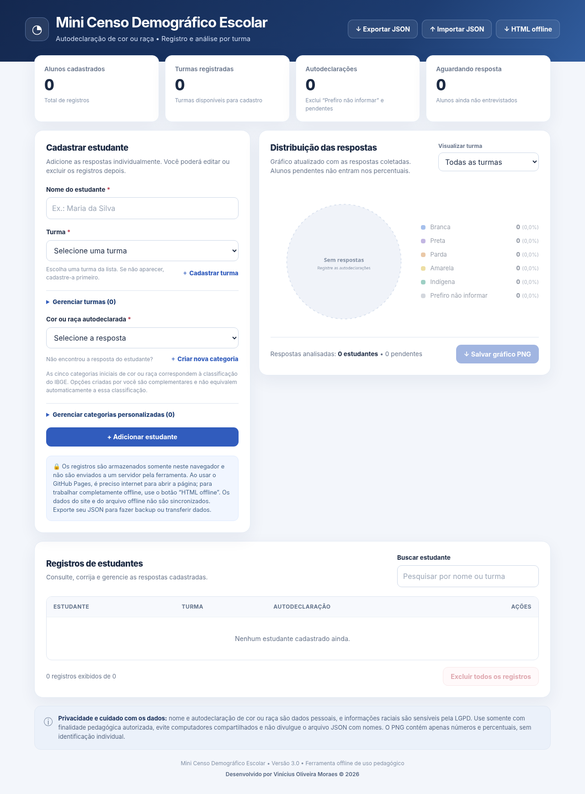

# Mini Censo Demográfico Escolar

**Versão 3.0 · Aplicação estática · Desenvolvido por Vinícius Oliveira Moraes © 2026**

Aplicação pedagógica para registrar e analisar a **autodeclaração de cor ou raça de estudantes** por turma. Funciona como página estática no GitHub Pages e também como um único arquivo HTML aberto localmente, sem instalação.



## Funcionalidades

- Cadastro, busca, edição e exclusão de estudantes;
- Cadastro, renomeação e remoção de turmas vazias;
- Categorias de autodeclaração iniciais e categorias adicionais personalizáveis;
- Filtro por turma e gráfico de pizza, com quantidades e porcentagens;
- Identificação de registros pendentes (excluídos dos percentuais);
- Exportação de gráficos em PNG e backup/importação em JSON;
- Persistência no armazenamento local do navegador;
- Layout responsivo para computador e celular.

## Publicar no GitHub Pages

1. Crie um repositório no GitHub (sugestão: `mini-censo-escolar`). Para uma conta GitHub Free, use um **repositório público** para publicar com Pages.
2. Envie **os arquivos e pastas deste pacote descompactado** à raiz do repositório. O arquivo `index.html` deve ficar na raiz, não dentro de uma pasta extra.
3. Vá a **Settings → Pages**.
4. Em **Build and deployment → Source**, selecione **Deploy from a branch**.
5. Selecione a branch **`main`** e a pasta **`/(root)`**, depois clique em **Save**.
6. O site ficará disponível em um endereço semelhante a `https://SEU_USUARIO.github.io/mini-censo-escolar/` (ajuste para seu usuário e nome real do repositório).

Não é necessário Node.js, npm, bibliotecas externas, configuração de banco de dados nem GitHub Actions. O arquivo `.nojekyll` mantém a publicação simples, sem processamento pelo Jekyll.

Guia oficial: [Configurar origem de publicação do GitHub Pages](https://docs.github.com/pt/pages/getting-started-with-github-pages/configuring-a-publishing-source-for-your-github-pages-site).

## Utilizar e fazer backup

1. Abra o site e cadastre as turmas ou importe um arquivo JSON anterior.
2. Cadastre/edite os estudantes e selecione a resposta autodeclarada, ou **Pendente de autodeclaração**.
3. Selecione uma turma para consultar os indicadores e o gráfico.
4. Use **Salvar gráfico PNG** para exportar a visualização agregada.
5. Use **Exportar JSON** regularmente e guarde o arquivo em local protegido.

**Para uso offline completo:** clique em **HTML offline** na página publicada, salve o arquivo e abra-o diretamente no navegador. O programa contido em `index.html` não depende de recursos externos.

### Atenção ao armazenamento

- Os registros ficam em `localStorage` no **navegador e na origem em que a página foi aberta**; não são armazenados no repositório GitHub pela aplicação.
- Abrir o arquivo HTML localmente e abrir o site do GitHub Pages **não compartilham automaticamente os dados**. Use **Exportar JSON / Importar JSON** para transferi-los.
- Navegadores/dispositivos diferentes, modos privados e limpeza de dados podem eliminar registros; faça backups regulares.
- O GitHub Pages requer internet para abrir/recarregar a página hospedada (não há service worker). O HTML salvo localmente funciona inteiramente offline.

## Privacidade e dados sensíveis

**NÃO publique no repositório arquivos JSON de estudantes, planilhas com nomes ou listas de autodeclaração.** Dados de cor ou raça são sensíveis pela LGPD, especialmente quando associados a estudantes identificáveis. O repositório deve conter **somente código e documentação sem dados reais**.

- O aplicativo não inclui contas ou autenticação; pessoas que usam o mesmo perfil do navegador podem acessar os dados locais.
- Não utilize computadores públicos ou compartilhados para registrar dados identificáveis sem as salvaguardas adequadas.
- Para uso institucional, alinhe a coleta, o acesso, a finalidade, o consentimento/base legal aplicável e a guarda dos dados com a escola e seus responsáveis.
- Sites de projetos hospedados no mesmo subdomínio `SEU_USUARIO.github.io` podem compartilhar a mesma origem de armazenamento no navegador. Isso é uma razão adicional para preferir o arquivo HTML local e um ambiente institucional controlado ao lidar com dados sensíveis, ou evoluir para autenticação e armazenamento adequados.
- Um repositório privado **não torna necessariamente o site GitHub Pages privado**; confirme a configuração de acesso antes de publicar.

## Estrutura do repositório

```text
mini-censo-escolar/
├── index.html          # Aplicação estática completa (HTML + CSS + JS)
├── assets/
│   └── preview.png     # Captura de tela ilustrativa, sem dados reais
├── README.md           # Documentação e instalação no Pages
├── CHANGELOG.md        # Histórico de desenvolvimento
├── LICENSE             # Condições de uso educacional com atribuição
├── .gitignore          # Evita adicionar backups e arquivos de estudantes via Git
└── .nojekyll           # Publicação como site estático
```

## Autoria e licença

Desenvolvido por **Vinícius Oliveira Moraes © 2026**. O rodapé apresenta a autoria visivelmente.

O arquivo [LICENSE](LICENSE) estabelece uma **licença educacional personalizada com atribuição**, permitindo uso e adaptação educacionais não comerciais com manutenção dos créditos. **Não é uma licença open source padronizada** e o GitHub pode exibi-la como licença personalizada. Para outros usos, entre em contato com o autor pelos canais em que o projeto foi disponibilizado.

Atribuir autoria não impede tecnicamente que alguém edite o HTML; o histórico de commits do GitHub ajuda a documentar a evolução do projeto.
